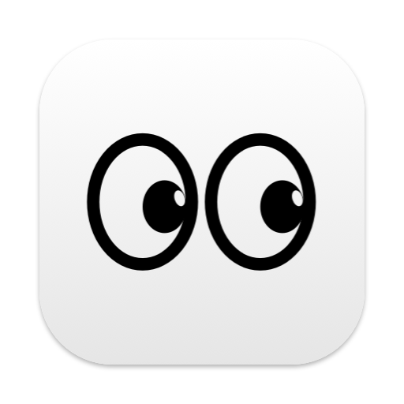

<p align="center">
  
</p>

<h1 align="center">DontSleep</h1>

<p align="center">
  A tiny macOS menu bar app with two eyes.<br>
  Eyes open: your Mac stays awake, <b>even with the lid closed on battery</b>.<br>
  Eyes closed: normal sleep.
</p>

<p align="center">
  <a href="https://github.com/emre-koc/dont-sleep/releases/latest"><b>Download the latest release</b></a>
  ·
  macOS 13+
  ·
  Apple Silicon &amp; Intel
  ·
  Signed &amp; notarized
</p>

---

## How it works

| Menu bar | State | What happens |
|:---:|---|---|
| <picture><source media="(prefers-color-scheme: dark)" srcset="docs/menubar-open-dark.png"></picture> | **Awake** | The Mac won't sleep, even when you close the lid on battery, with no external display. |
| <picture><source media="(prefers-color-scheme: dark)" srcset="docs/menubar-closed-dark.png"></picture> | **Normal sleep** | The sleep settings in System Settings apply, exactly as if the app weren't running. |

- **Left-click** the eyes to switch.
- **Right-click** for the menu: current status, chip temperature, Settings…, Launch at Login, Quit.

`caffeinate` and power assertions can't keep a MacBook awake once the lid closes on battery. DontSleep uses `pmset disablesleep`, which can, and it puts normal sleep back as soon as you close
the eyes or quit.

## Install

1. Download `DontSleep-<version>.dmg` from [Releases](https://github.com/emre-koc/dont-sleep/releases/latest).
2. Open it and drag **DontSleep** into **Applications**.
3. Launch it. The eyes appear in your menu bar; there's no Dock icon.
4. Optional: right-click the eyes and turn on **Launch at Login**.

The first time you open the eyes, macOS asks for your admin password **once**
([why](#permissions)).

## Safety guards

A closed MacBook that stays awake in a bag can get hot or run flat. DontSleep closes the eyes
automatically (back to normal sleep) when:

| Guard | Default | Adjustable |
|---|---|---|
| 🌡️ **Chip too hot**: average of the last 3 readings, taken every 15 s | 85 °C | 60–105 °C |
| 🔥 **macOS reports heavy thermal pressure** | On | On / Off |
| 🔋 **Battery low** (on battery only) | 10 % | 5–50 % |

All three are in **Settings…** (right-click → Settings, or ⌘,), which also shows the live chip
temperature. When a guard trips, the menu tells you why, and the app won't reopen the eyes until the Mac
is back within the limits.

Quitting, logging out or shutting down always restores normal sleep.

> **Intel Macs:** the chip temperature sensor isn't available, so only the thermal-pressure and battery
> guards apply.

## Permissions

Disabling lid-close sleep needs root. Instead of asking for your password on every click, DontSleep
installs one narrow rule at `/etc/sudoers.d/dont-sleep` the first time you open the eyes. The rule lets
your user run exactly these two commands, and nothing else, without a password:

```
/usr/bin/pmset -a disablesleep 0
/usr/bin/pmset -a disablesleep 1
```

The file is checked with `visudo` before it's installed, and it's owned by `root:wheel` with mode `440`.

## Uninstall

1. Quit DontSleep from its menu, which restores normal sleep.
2. Delete `DontSleep.app` from Applications.
3. Remove the sudoers rule:

```bash
sudo rm /etc/sudoers.d/dont-sleep
```

If the app ever crashed while the eyes were open, restore normal sleep by hand:

```bash
sudo pmset -a disablesleep 0
```

## Build from source

You need the Xcode Command Line Tools (Swift 5.9+). There's no Xcode project: [build.sh](build.sh)
compiles the Swift files with `swiftc`.

```bash
git clone https://github.com/emre-koc/dont-sleep.git
```

```bash
cd dont-sleep && ./build.sh && open DontSleep.app
```

`./build.sh` builds for your Mac only, ad-hoc signed.

### Release build

`./build.sh release` builds a universal (arm64 + x86_64) app, signs it with your Developer ID and the
hardened runtime, notarizes and staples it, and writes `dist/DontSleep-<version>.zip` and
`dist/DontSleep-<version>.dmg`.

Save your notarization credentials once, with an app-specific password from
[account.apple.com](https://account.apple.com):

```bash
xcrun notarytool store-credentials DontSleep --apple-id YOUR_APPLE_ID --team-id YOUR_TEAM_ID
```

```bash
./build.sh release
```

| Variable | Purpose |
|---|---|
| `SIGN_ID` | codesign identity (default: the first "Developer ID Application" in your keychain) |
| `NOTARY_PROFILE` | notarytool keychain profile (default: `DontSleep`) |
| `SKIP_NOTARIZE=1` | sign and package without notarizing |

Bump `CFBundleShortVersionString` in [Info.plist](Info.plist) for each release.

## Project layout

```
Sources/main.swift        App: menu bar item, power control, guards, settings window
Sources/EyeIcon.swift     Eye artwork, drawn as vectors (menu bar + app icon)
Tools/AppIcon/main.swift  Renders the app icon from EyeIcon.swift
Info.plist                Bundle settings (menu bar only, no Dock icon)
build.sh                  Dev and release builds
```
